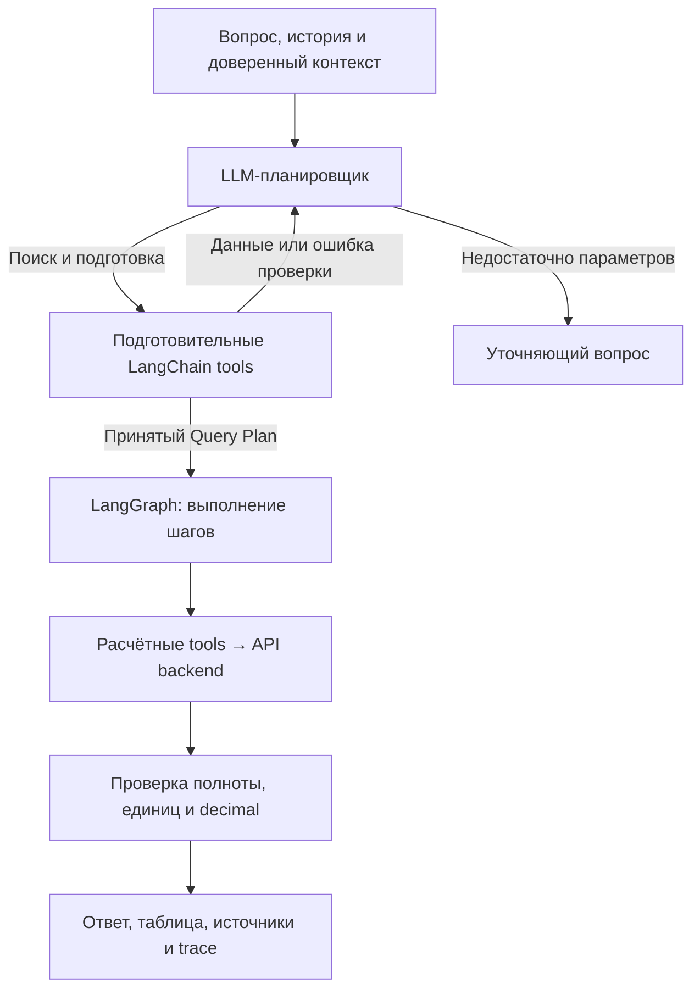

# ridgitech-1c-ai

Базовый агент на LangGraph для аналитических вопросов к данным 1С.
Модель - `qwen/qwen3.8-27b` через OpenRouter, как в `qwen.md`.
Для прогонов используется синтетический backend: продажи, топ контрагентов,
поступления по направлению и остатки взаиморасчётов.

## Быстрый запуск

Команды выполняются из корня репозитория. Нужен Python 3.12+.

```bash
python3.12 -m venv .venv
.venv/bin/python -m pip install -e .
cp .env.example .env
```

Впиши ключ в `OPENROUTER_API_KEY` внутри `.env`. Файл исключён из Git.
По умолчанию используется Qwen3.8-27B; `QWEN_MODEL` меняет модель OpenRouter.

Один вопрос:

```bash
.venv/bin/python -m agent run 'Посчитай продажи за январь 2025' --organization demo-org
```

Сначала короткий прогон трёх вопросов:

```bash
.venv/bin/python -m agent eval --limit 3 --out runs/baseline-small
```

Полный набор:

```bash
.venv/bin/python -m agent eval --cases evals/cases.jsonl --out runs/baseline
```

Также устанавливается команда `ridgitech-agent` с теми же аргументами.
Без ключа CLI выводит сообщение о настройке `OPENROUTER_API_KEY`.
Синтетические данные обозначены в источниках и предупреждениях каждого ответа.

## Как устроен агент



Планировщик получает пять подготовительных tools. Четыре расчётные операции
передаются ему как схемы шагов плана. После `submit_query_plan` граф сам вызывает
расчётные инструменты, соблюдая зависимости и лимит параллельных шагов.
Суммы и сравнения периодов вычисляются кодом через `Decimal`.

Неоднозначный вопрос возвращает `needs_clarification`. Уточнение можно передать
следующим вызовом с историей в UTF-8 файле через `--history path/to/history.txt`.
`current_date` и временная зона задаются backend; в CLI дату фиксирует `--today`.

Обработка ограничена общим deadline до 60 секунд, числом вызовов модели и бюджетом
инструментов. Неполная выгрузка завершается ошибкой. Ответ содержит нормализованный
план, данные, источники, предупреждения, trace, время, токены и стоимость,
если провайдер сообщил её для всех вызовов.

## Прогоны и улучшения

[evals/cases.jsonl](evals/cases.jsonl) содержит 14 вопросов с эталонами:
четыре бизнес-сценария, группировка, сравнение периодов, относительные даты,
уточнения, неподдерживаемый показатель, пустая выборка, лимит и запрет доступа.
Время в кейсах фиксировано на 11.11.2026 для воспроизводимой трактовки «сегодня».

Прогон сохраняет:

| Файл | Что внутри |
|---|---|
| `results.jsonl` | Вопрос, контекст, эталон, фактический ответ, план, trace, оценки, вызовы backend |
| `summary.json` | Число проверок, доля успешных, среднее время/p95, токены, стоимость, список ошибок |
| `manifest.json` | Модель, параметры генерации, версии библиотек, Git/code/data hashes |
| `prompt.md`, `tools.json` | Снимки промпта и схем tools |
| `cases.jsonl` | Снимок использованных вопросов и эталонов |

Папки `runs/` исключены из Git. Файлы пишутся после каждого кейса;
`complete` и `planned_cases` показывают, завершён ли набор.
Существующий непустой каталог результатов не перезаписывается.
Код завершения CLI: `0` - все эталоны пройдены, `1` - есть несовпадения,
`2` - ошибка конфигурации.

Промпт находится в [agent/prompts/system.md](agent/prompts/system.md).
Для отдельного эксперимента передай свой файл:

```bash
.venv/bin/python -m agent eval --prompt experiments/prompt-v2.md --out runs/prompt-v2
.venv/bin/python -m agent compare runs/baseline runs/prompt-v2
```

Сравнение показывает улучшившиеся и ухудшившиеся кейсы, качество и затраты.
Сравниваются одинаковые вопросы, контекст, эталоны и данные.
Для другой конфигурации модели доступны `--reasoning low`, `--temperature`,
`--max-tokens`, `--max-turns`, `--max-parallel`, `--seed` и `--repeat`.
Seed фиксируется в отчёте; результат зависит также от провайдера модели.

## Подключение реальных компонентов

[AnalyticsAgent](agent/graph.py) принимает любой LangChain `BaseChatModel`
с `bind_tools` и клиент, реализующий [AnalyticsBackend](tools/_runtime.py).
Это точки подключения локальной модели и API Григория.
[FixtureBackend](agent/fixture_backend.py) реализует тот же контракт на тестовых данных.
URL и форматы HTTP-методов задаются в адаптере реального API.

OpenRouter используется для этих тестовых прогонов. Целевая on-prem схема
сохраняется как [архитектура PNG](docs/agent/architecture.png) / [SVG](docs/agent/architecture.svg).
Текущий CLI сохраняет результаты локально; PostgreSQL, Redis и интерфейс чата
относятся к дальнейшей интеграции backend.

## Tools и тесты

- [9 tools: Python и Markdown](tools/)
- [Контракты и подключение tools](docs/agent/tools.md)
- [Тесты графа, провайдера и прогонов](tests/test_agent.py)

```bash
.venv/bin/python -m unittest discover -s tests -v
```

Автотесты работают без сети с подменёнными ответами модели. Они проверяют
оркестрацию и расчёты, а качество Qwen измеряется командой `eval` с реальным ключом.

Протокол провайдера: [OpenRouter Qwen3.8-27B](https://openrouter.ai/qwen/qwen3.8-27b/llms.txt),
[официальная интеграция LangChain](https://docs.langchain.com/oss/python/integrations/chat/openrouter).
Ранний учебный прототип сохранён в ветке
[draft/agent-prototype](https://github.com/Dez0117/ridgitech-1c-ai/tree/draft/agent-prototype).
