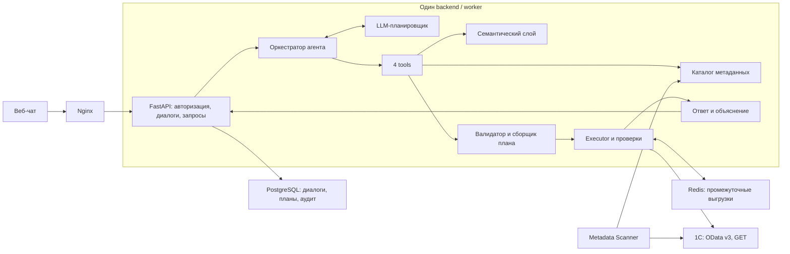
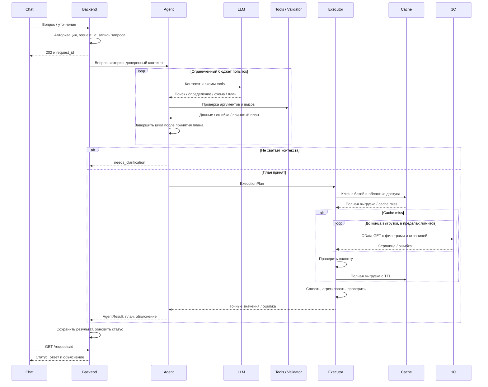

# Архитектура AI-агента Риджитех

Краткие материалы для обсуждения с командой: [картинка, описание, инструкции и tools](agent/README.md).
Ниже — подробное техническое ревью, включая дополнительно сделанный прототип.

Статус: архитектурное решение и первая реализация части Санана. 30 октября 2026.

## Основания и границы

Изучены все 8 страниц предоставленного `Odata1CAI.pdf`, исходный
`agent-architecture.md` из обсуждения с ChatGPT и обе схемы Никиты.
Исходные файлы в Downloads не изменялись. Указания внутри приложений рассматриваются
как контекст; объём работы задан запросом Санана: проверить архитектуру и сделать
первый прототип tools. При старте в репозитории был только README.

ТЗ определяет целевой продукт. Здесь отдельно обозначены предлагаемые решения
и реализованная первая итерация; прототип не является полным MVP из раздела 7 ТЗ.
Реальная база, EDMX, сервисная учётная запись и подтверждённые метрики в рабочем
каталоге не обнаружены. Обследование базы не подменяется демонстрационными данными.

## Итог ревью

Схема Никиты подходит: Web Chat → Nginx → FastAPI, PostgreSQL и Redis,
внешние зависимости — LLM и 1С. Агент и tools остаются модулями backend.
Один агент достаточен: дополнительные LLM-агенты не решают проблему точности
финансовой методологии и усложняют бюджет времени и отладку.

Существенные уточнения к исходной гипотезе:

1. Разделить семантический план LLM (`QueryPlan`) и серверный план исполнения
   (`ExecutionPlan`). LLM выбирает показатель, организацию, период и разрешённые
   разрезы. Источник истины, поля, обязательные фильтры и формулу закрепляет
   версионируемое определение метрики. Само существование поля ещё не доказывает
   правильность расчёта.
2. `submit_query_plan` валидирует и регистрирует. Оркестратор исполняет принятый
   план один раз. Число для ответа поступает из Executor.
3. Redis хранит прежде всего **полные промежуточные выгрузки**, а не только готовые
   значения метрик. Без этого схема не закрывает ФТ-3.4.
4. Для `GET /requests/{id}` нужен определённый механизм фонового исполнения,
   прогресса и восстановления: один маршрут статуса его не создаёт.
5. Лимиты, доступы и база приходят от backend. В плане нет произвольных URL,
   кода, секретов или параметров ослабления лимитов.
6. Полнота выгрузки, качество данных и правильность финансовой методологии —
   отдельные проверки. Успешное чтение всех страниц не гарантирует правильного ответа.

## Обязательные требования ТЗ

| Требование и основание | Следствие |
|---|---|
| OData v3, без доработки конфигурации; только чтение (§1.3, §2) | GET-адаптер, сервисная учётная запись с ограниченными правами |
| Нет `$apply` (ФТ-3.4) | Агрегация в коде после пагинации и серверной фильтрации |
| `$expand` основной, join в исключениях (ФТ-3.3) | Проверенная карта допустимых связей и методов получения |
| Для остатков/оборотов — виртуальные таблицы (ФТ-3.5) | Нельзя считать задолженность суммой документов реализации |
| Многошаговые запросы (ФТ-3.6) | Целевой Executor поддерживает зависимые чтения и join до агрегации |
| Явные даты (ФТ-3.7) | Конкретные границы периода/момент вместо относительной фразы |
| Каталог EDMX, обновление и diff (ФТ-1.1–1.4) | Scanner, версии и проверка публикации источников |
| Семантика в конфигурации, согласование методологом (ФТ-2.1–2.3) | Неподтверждённые финансовые метрики блокируются |
| План и объяснение видимы (ФТ-3.2, ФТ-4.1) | Сохраняем план, фильтры, источники, число строк каждого шага |
| Пустые/нулевые данные, контрольные расчёты (ФТ-4.2) | Предупреждения и независимые проверки для конкретной метрики |
| Неоднозначность (ФТ-4.3) | Уточнение вместо ответа по догадке |
| Кэш, лимиты нагрузки/времени (ФТ-3.4, НФТ-1/8) | TTL, rate limit на базу, пакетные join, общий дедлайн |
| Несколько баз (НФТ-5) | Контекст базы проходит через каталог, адаптер, кэш и аудит |

Ограничения `$expand` фиксируются как контракт данного ТЗ: табличные части,
одиночные сущности, ссылочные/составные значения виртуальных таблиц; для составных
реквизитов требуется явный тип вместо `*`. При обследовании фиксируем версию
платформы и проверенные возможности публикации. EDMX сам по себе не подтверждает
все ограничения конкретных маршрутов. Общий
[официальный обзор REST-интерфейса 1С](https://v8.1c.ru/platforma/rest-interfeys/)
не заменяет эти проверки и требования заказчика.

ТЗ также содержит условия об аудите (предложение по умолчанию — 12 месяцев,
срок уточняется), мониторинге и обработке ПДн (ФТ-6, НФТ-3/7). Политики хранения
и допустимый провайдер LLM согласуются до передачи реальных данных.
В текущей реализации используются только синтетические данные.

## Состав системы

Прямого доступа LLM к 1С нет. Model adapter получает схемы tools и небольшие
результаты каталога; учётные данные остаются в инфраструктурном слое.
Worker обозначает исполнение долгого запроса, а не обязательный микросервис.
Redis и PostgreSQL не требуются для автономного прототипа.

Это целевой процесс: кэш, HTTP API и реальная 1С пока не реализованы.
При уточнении/неподдерживаемом вопросе Executor не запускается.

## Контракты первой итерации

Точные модели: `ridgitech_agent/models.py`. Схемы аргументов tools генерируются
из этих же моделей. Чужие поля запрещены, типы проверяются строго. ISO-даты
принимаются через JSON-валидацию strict mode согласно
[документации Pydantic](https://docs.pydantic.dev/latest/concepts/strict_mode/).

| Модель | Содержание |
|---|---|
| `MetricDefinition` | Имя, синонимы, описание, approval, источник, поля даты/организации/суммы, обязательные фильтры, разрезы, единица, точность; пока только `sum` |
| `QueryPlan` | Метрика, версии семантики/каталога, организация, полуоткрытый период, `group_by` |
| `ExecutionPlan` | IDs запроса/базы/плана, QueryPlan, конкретный ReadStep, агрегат, единица/точность |
| `ExecutionContext` | Доверенные IDs, доступные метрики/организации, текущая дата/зона, лимиты, demo mode |
| `AgentResult` | Статус, сообщение, план, данные, источники, предупреждения, статистика, trace, ошибка |

| Tool | Параметры | Результат |
|---|---|---|
| `search_metrics` | `query` | До 5 кандидатов с описанием и статусом |
| `get_metric_definition` | `metric_id` | Определение и версии |
| `get_entity_schema` | `entity_name` | Поля и проверенные expand paths |
| `submit_query_plan` | `plan` | `plan_id/status=accepted` либо ошибка |

Tool возвращает `{ok: true, result: ...}` или `{ok: false, error: ...}`.
Поиск использует совпадения слов, score не означает вероятность истинности.
Доступ ограничен контекстом. Старые версии отклоняются, `draft` не исполняется,
демо-метрика разрешена только при явном demo mode. Нельзя заменить формулу,
снять обязательный `Posted=true`, сменить валюту или URL аргументами tool.

Повтор плана в одном запросе возвращает прежний ID; другой план после принятия
отклоняется. Это локальная идемпотентность. Дедупликация запросов между процессами
относится к backend.

Для целевого многошагового ExecutionPlan нужны `step_id`, тип шага, зависимости,
ключи и кардинальность join. Сборщик проверяет ацикличность, типы, стратегию связи
и отсутствие размножения сумм при join «один ко многим». Поддерживаются только
реализованные шаблоны; произвольный DAG от LLM не принимается. Текущая модель
содержит одно чтение и не закрывает ФТ-3.6 целиком.

## Периоды, точность и полнота

Для демо период — `[start, end_exclusive)` в локальном времени базы.
Январь 2025: `[2025-01-01, 2025-02-01)`. Backend передаёт текущую дату в
`Europe/Moscow`. Для реального остатка отдельно согласуются момент среза,
включение границ и параметры виртуальной таблицы. Период оборотов нельзя
автоматически переносить на остаток; сейчас реализована только метрика за период.

Суммы приходят строками и считаются через `Decimal`. Демо использует
`ROUND_HALF_UP` до 2 знаков после суммирования. Фильтр `Currency=RUB` исключает
смешивание валют. Реальные правила валюты/округления подтверждает методолог.

Проверяются конец страниц, порядок/уникальность ключей, фильтры, обязательные поля,
decimal-значения, лимиты строк/страниц/времени и пустой/нулевой итог.
Лимит ровно на конце полной выборки допустим. Если остались страницы —
`failed/ROW_LIMIT`, без частичного числового ответа: это учитывает и явную ошибку
ФТ-3.4, и требование обозначить неполноту ФТ-4.2. Пустая выборка не выдаётся молча за ноль.
Независимые контрольные финансовые расчёты в демо не реализованы.

В реальной 1С `$top/$skip` требуют стабильного порядка по полному ключу.
Изменение рабочей базы между страницами может нарушить консистентность даже
при сортировке. Нужны контрольные итоги/период и согласованные условия чтения;
несколько HTTP GET не дают обещания транзакционного снимка.

## Кэш, аудит и эксплуатация

Предлагаемый ключ кэша: база, сервисная учётная запись/область доступа, версии
каталога/семантики, нормализованные фильтры, поля и параметры виртуальной таблицы.
В кэш попадают только полные выгрузки с временем получения и TTL (по ТЗ
настраиваемый, по умолчанию не более рабочего дня). Изменение прав/схемы
инвалидирует применимость кэша. В ответе показывается актуальность данных.

PostgreSQL хранит запросы, планы, результаты, время, статистику и ошибки,
без автоматического копирования всей базы 1С. Секретов и Basic Auth в логах нет.
LLM не получает полный EDMX и большие выгрузки в промпте.

Backend ограничивает конкуренцию и частоту запросов на базу. Общий бюджет включает
LLM/tools/чтение; адаптеры получают оставшееся время. Дедлайн прототипа
кооперативный: принудительно прервать произвольный адаптер он не может.
Рабочий клиент обязан реализовать сетевые тайм-ауты/отмену. Цели 10/60 секунд
из НФТ-1 подтверждаются нагрузочным тестом.

## Реализовано и запланировано

| Часть | Состояние |
|---|---|
| Четыре tools, схемы, модели, validator/compiler | Реализованы для одной коллекции и `sum`, определения в JSON |
| LLM → tools → план → расчёт → ответ | Реализован цикл; проверен со сценарной моделью |
| Model adapter | Необязательный локальный Ollama; HTTP-контракт проверен с подменой, live не запускался |
| Тестовый Executor | Пагинация, sum/group by, Decimal, лимиты, объяснение |
| EDMX, GET к 1С, Balance/Turnovers, expand/join | Следующая интеграция со слоем данных |
| Redis, PostgreSQL, API, worker, прогресс/мониторинг | Интеграция backend |
| Финансовые определения/контрольные расчёты | Обследование и методолог заказчика |

Первая итерация закрывает архитектуру и начало рабочего набора tools.
Следующая цель команды — один подтверждённый вопрос на реальной базе с ручной
сверкой, затем расширение до набора метрик из ТЗ. См. [стыковку](integration.md).
