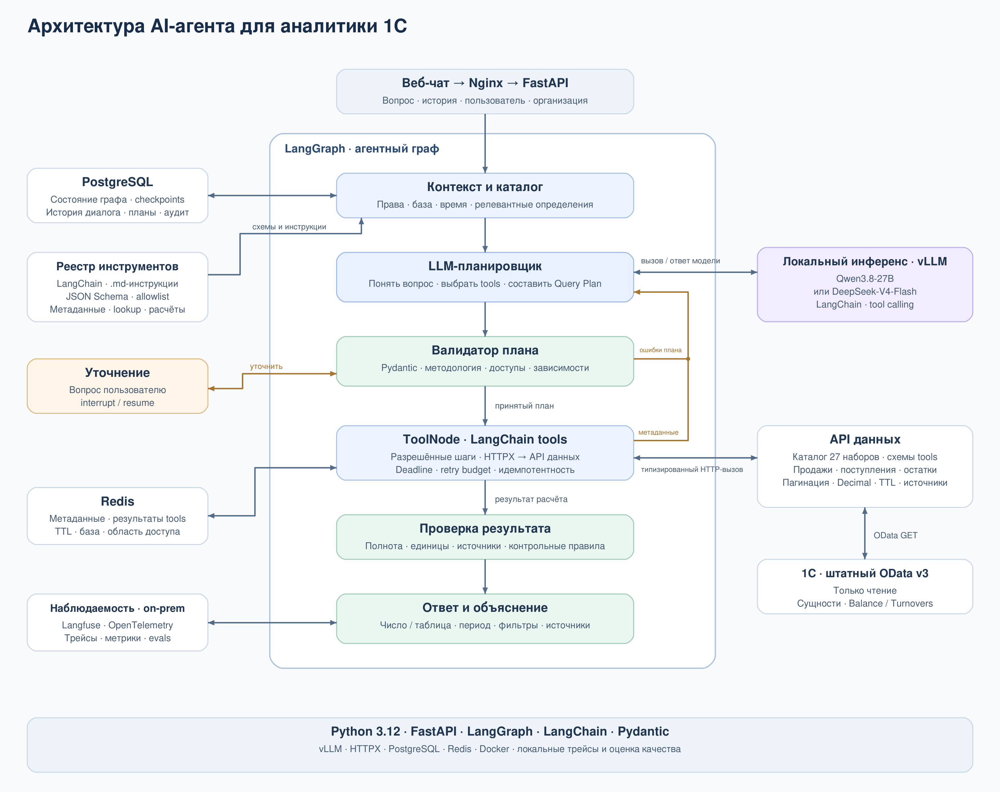

# Проектирование AI-агента для аналитики 1С

Материалы Санана для обсуждения с командой. Дата: 30.10.2026.
Основание — предоставленное ТЗ `Odata1CAI.pdf` и схема backend Никиты.
Это предложение архитектуры и контрактов, а не утверждение готовности всей системы.

## Результат текущего этапа

1. Архитектура агента: состав модулей, их взаимодействие и границы ответственности.
2. Базовый набор tools: назначение, условия вызова, аргументы, результаты и ошибки;
   отдельно — общие инструкции для LLM.

Формулировка «приступить к созданию tools» допускает небольшой программный каркас,
но не требует сквозного рабочего демо до согласования схемы и источников данных.
Подготовленный ранее код остаётся дополнительным экспериментом.

## Схема

[PNG для отправки команде](architecture.png) · [редактируемый SVG](architecture.svg)

Это логические модули внутри backend Никиты. LLM может вызываться по HTTP;
отдельный сервис агента на первом этапе не нужен. Конкретная модель пока не выбрана.

## Что делает каждый блок

| Блок | Ответственность |
|---|---|
| Контекст backend | Передаёт вопрос, историю, выбранную базу, доступы, текущую дату и временную зону; секреты в промпт не попадают |
| LLM-планировщик | Понимает вопрос, ищет метрику, определяет недостающие параметры и предлагает структурированный план |
| Диспетчер tools | Принимает вызов модели, проверяет схему аргументов, вызывает разрешённую функцию и возвращает результат |
| Семантический слой | Хранит согласованные определения метрик, обязательные фильтры, единицы и способы связывания данных |
| Каталог EDMX | Описывает реальные сущности, поля, типы, связи и проверенные возможности опубликованной 1С |
| Валидатор и сборщик плана | Проверяет параметры, права и версии; подставляет разрешённые источники и правила расчёта из определения метрики |
| Executor | Читает OData постранично, получает связи, считает точные суммы, проверяет полноту и лимиты |
| Сборщик ответа | Возвращает число/таблицу, единицу, период, источник, предупреждения и объяснение расчёта |

Один агент-планировщик достаточен для первой версии. Источники и финансовую
формулу нельзя выбирать по догадке модели; их подтверждают при обследовании.

## Порядок обработки

1. Backend передаёт вопрос и доверенный контекст.
2. Агент вызывает `search_metrics`, затем получает определение метрики и схему источника.
3. Если показатель, организация или дата неоднозначны — задаёт уточняющий вопрос.
4. Агент вызывает `submit_query_plan`. Валидатор возвращает ошибки для исправления
   либо принимает план; число исправлений ограничено.
5. Оркестратор передаёт принятый план исполнителю. Сам tool выгрузку не запускает.
6. Executor получает данные, считает результат и возвращает проверки/статистику.
7. Backend отдаёт ответ и сохраняет план и объяснение для аудита.

## Требования ТЗ, которые влияют на поведение

- Доступ к 1С только на чтение через OData v3; `$apply` не используется.
- Агрегация выполняется сервисом после серверной фильтрации и постраничной выгрузки.
- `$expand` — основной способ получения связей. Для перечисленных в ТЗ исключений
  (табличные части, одиночные сущности, связи виртуальных таблиц) используется пакетный join.
- Остатки и обороты берутся из соответствующих виртуальных таблиц. Задолженность
  не заменяется произвольной суммой документов.
- Неоднозначность требует уточнения; пустая выборка — явного предупреждения.
- Превышение лимита не превращается в полный числовой ответ.
- Кэшируются промежуточные выгрузки с TTL; сохраняются план и объяснение расчёта.

Основания: §1.3, ФТ-2.1–2.3, ФТ-3.1–3.7, ФТ-4.1–4.3 исходного ТЗ.

## Инструкции и tools

- [Инструкции для агента](agent-instructions.md) — черновик системного промпта и примеры поведения.
- [Базовые tools](tools.md) — четыре контракта для согласования и дальнейшей реализации.

Tools — вызываемые функции. Инструкции объясняют модели, когда и как ими
пользоваться. Здесь описаны обе части; конкретный SDK для этого не требуется.

## Что согласовать перед реализацией на реальных данных

Григорий уточняет реальные сущности, поля, связи и определения первых метрик
вместе с методологом заказчика. Никита — контекст вызова, хранение и жизненный цикл
запроса. Санан — инструкции, tools и формат плана. Владельцев промышленного
Metadata Scanner и OData Executor команда фиксирует отдельно.

Первый следующий шаг: выбрать один вопрос из ТЗ, описать его метрику на реальной
схеме и проверить, что предложенных tools достаточно для построения плана.
Модель и способ её подключения выбираются после этого.
